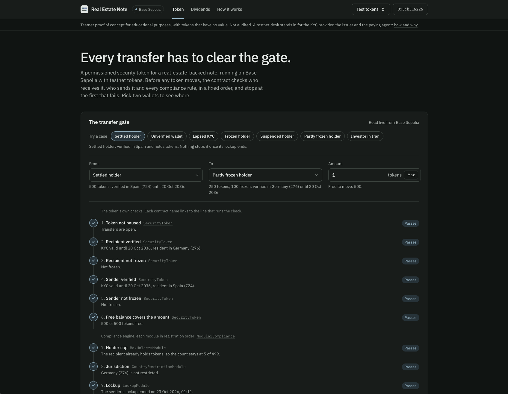

# EVM RWA Security Token

[](https://github.com/GushALKDev/evm-rwa-security-token/actions/workflows/test.yml)
[](LICENSE)
[](https://docs.soliditylang.org/en/v0.8.24/)
[](https://book.getfoundry.sh/)

A proof of concept for educational purposes: compliant tokenization of a real-world financial asset (a real-estate-backed note) as a permissioned security token, modeling the identity, compliance, and custody architecture used by regulated digital-asset platforms.

> **Proof of concept for educational purposes. Not audited and not deployed on any mainnet.** This code is not fit for production or for representing real financial instruments.

**Status.** All nine phases of the [roadmap](#roadmap) are complete: the identity registry, the compliance engine and its four modules, document anchoring, the token, deployment, the test suites, the documentation and the dividend distributor. The code was then reviewed in three rounds (see [Review](#review)).

**Demo app:** a web interface in [`app/`](./app/README.md) runs the token on Base Sepolia with testnet tokens: walk every check of the transfer gate on seeded wallets, verify a wallet, receive and send tokens, pay a coupon and claim its share, with each check cross-checked against the contract.

**Live demo:** https://rwa-poc.gushalk.workers.dev

[](https://rwa-poc.gushalk.workers.dev)

---

## Highlights

- **A coherent ERC-3643 (T-REX) subset, written from scratch** on OpenZeppelin primitives: identity registry, modular compliance engine and gated transfer, plus ERC-1643 document anchoring. Differences from the standard are listed function by function and asserted by conformance suites.
- **One gate for every balance change.** Every mint, burn and transfer funnels through `_update`, and the public `canTransfer` pre-check runs the same status-code function as the enforcement, so for transfers and mints the two cannot drift.
- **Signed identity attestations.** Investors can be onboarded with an EIP-712 attestation from the KYC provider, bound to the chain, the registry, an expiry and a per-investor nonce.
- **Pluggable rules with guarded state.** Holder cap, jurisdiction blocklist and lockup are modules on an engine the token references; the engine refuses to attach a stateful module it cannot keep in step with existing balances.
- **Recovery that relocates a position without laundering it.** A custodian can move a lost wallet's balance only to a verified wallet of the same investor, and freezes, the lockup start and unclaimed dividends travel with it.
- **Dividends without enumeration.** A distributor module accrues income per holder with an accumulator, pays by pull, and rounds so that it stays solvent.
- **Reviewed and tested.** 421 tests including 12 stateful invariants, 100% branch and function coverage on every `src/` contract, and three review rounds whose 13 bugs each have a regression test that failed against the unfixed code.

---

## Demo app

A web app in [`app/`](app/) runs the token on Base Sepolia with testnet tokens.

- **Without a wallet:** walk every check of the transfer gate on seeded wallets, each set up to show one outcome of the gate.
- **With a wallet:** verify it at a testnet desk, receive tokens, send them through the gate, pay a coupon and claim your share. The desk stands in for the KYC provider, the issuer and the paying agent.
- **Deployment:** [`script/testnet/`](script/testnet/) runs `script/Deploy.s.sol`'s deployment unchanged, then, through the contracts' own functions:
  - attaches the dividend distributor;
  - restricts two jurisdictions;
  - shortens the lockup from 365 days to 5 minutes, so a visitor can see it lift.

What each stand-in checks and what it does not, how to run the app against a local chain, and how to deploy it: [app/README.md](app/README.md).

---

## The asset

A **Series A real-estate-backed note**: a debt instrument secured by a residential property in Valencia, Spain, held through an SPV, issued by a fictional entity to a whitelist of accredited investors (the registry stores an `accredited` flag, but no module reads it, so the token does not enforce accreditation). Face value 1,000 EURC per token, 36 month maturity. The governing terms live in [`docs/RealEstateNote-Terms.md`](docs/RealEstateNote-Terms.md) and are anchored on-chain by content hash.

The asset choice matters for the architecture. A note is a claim on a real property against a real issuer, enforceable in a real court. The register of who owns that claim has to be legally defensible, which is what drives every design decision below: transfers are restricted because securities law restricts them, balances can be frozen because courts order freezes, and lost wallets can be recovered because losing a private key does not extinguish legal ownership.

## Why a permissioned token is not an ERC-20

A plain ERC-20 answers one question: does the sender have the balance? A security token has to answer a different one: **is this specific transfer, between these two specific parties, legal right now?**

That inverts the default. In an ERC-20, transfers are permitted unless the balance is insufficient. Here, transfers are forbidden unless identity and compliance both approve. Concretely:

| | ERC-20 | Permissioned security token |
|---|---|---|
| Who may hold | Anyone with an address | Only KYC-verified investors, and only while their attestation is current |
| Transfer check | Balance sufficiency | Balance, sender and recipient identity, freeze state, pause, plus a composable rule set |
| Issuer powers | None after deploy | Mint, burn, freeze (full and partial), pause, forced recovery |
| Lost keys | Funds are gone | Custodian moves the position to a new verified wallet; ownership survives the key |
| Rules change | Redeploy the token | Add or remove a compliance module; the token is untouched (with limits for stateful modules, see [Architecture](#architecture)) |

The ERC-20 interface is preserved so that existing tooling can read balances and construct transfers. The semantics underneath are different, and a wallet that assumes ERC-20 semantics will see reverts it does not expect. That is intentional: the revert is the compliance boundary doing its job.

---

## Standards and scoping

This project implements a **coherent subset, written from scratch**, of two standard families:

- **[ERC-3643](https://eips.ethereum.org/EIPS/eip-3643) (T-REX)** for the identity and compliance model: the identity registry, the modular compliance engine, and the gated transfer.
- **[ERC-1643](https://github.com/ethereum/EIPs/issues/1643)** (from the [ERC-1400](https://github.com/ethereum/EIPs/issues/1411) family) for document anchoring. Neither reached Final status, so the concept is borrowed rather than the specification implemented.

**This is an educational reimplementation.** A production deployment would build on the audited [`@tokenysolutions/T-REX`](https://github.com/TokenySolutions/T-REX) reference implementation rather than rewriting the standard. Everything here is written from OpenZeppelin primitives on purpose: the goal is to demonstrate understanding of the architecture, not to deploy existing code.

Deliberately left out: the ONCHAINID identity contracts and their registries (collapsed into one flat registry with a single claim signer), generic claim topics (typed attributes instead), ERC-1400 partitions, and upgradeability. Why each exclusion is safe and what it costs: [Guide 4, scope decisions](docs/04-tradeoffs.md#2-scope-decisions). Which ERC-3643 functions and events exist, differ or are missing: [Guide 4 §2.6](docs/04-tradeoffs.md#26-erc-3643-surface-implemented-and-not-implemented).

### The two registration paths

The identity registry accepts records through two doors, which exist to make an argument about trust:

1. **`registerIdentity`** (AGENT only). The compliance officer writes the record directly, transcribing an off-chain KYC result. Trust rests entirely on the agent: a compromised agent key writes whatever it likes.
2. **`registerIdentityWithAttestation`** (permissionless to submit). The caller supplies an EIP-712 attestation signed by the authorized claim signer. The registry recovers the signer and rejects anything it did not sign. Trust rests on the signature, not on whoever pays for the transaction.

The second path is ERC-3643's trust model in miniature, and it is the reason the standard bothers with ONCHAINID at all: **verification should not rest on trusting whoever writes to the registry.** The domain separator stops replay on another chain or registry, the expiry stops replay after the KYC lapses, and a per-investor nonce, advanced by every write to the record, stops a still-valid attestation from silently re-registering an investor the agent has just removed. The replay analysis: [Guide 2 §3](docs/02-mathematics.md#3-replay-the-three-axes-and-what-closes-each).

### Why the lockup runs from initial acquisition, not from each acquisition

This is a case where excluding a feature forced a different rule, and the two cannot be reasoned about separately.

The anchored terms document specifies a 12-month lockup. The obvious reading is per-acquisition: every time you receive tokens, those tokens are locked for a year. Implemented literally on a fungible balance, that means **every incoming transfer restarts the clock on the entire position**, and that is a vulnerability, not a rule:

> Anyone can send a victim 1 wei of the token and re-lock their whole position for another year. It costs the attacker one dust transfer and can be repeated forever. A lockup a hostile third party can trigger against you for free is a denial of service wearing a compliance costume.

The strict reading is only implementable if each **parcel** of tokens carries its own clock, which is precisely what ERC-1400 partitions provide, and partitions are out of scope. So the clock starts on the transition from zero to a positive balance (by mint or by transfer), later receipts never reset it, and exiting to zero clears it. That single guard (`lockStart != 0`, do not overwrite) is the anti-griefing property, tested explicitly, including the 1-wei re-lock attempt. The anchored terms say "from initial acquisition" so that the legal document and the contract describe the same instrument.

---

## Architecture

Eight contracts: the seven that `Deploy.s.sol` deploys, plus the optional `DividendDistributor`. An investor mostly touches the token, which consults the rest on their behalf; the exceptions are `claim` on the distributor and the permissionless `registerIdentityWithAttestation` on the registry.

```
     ISSUER            AGENT                CUSTODIAN
   (mint, burn,   (freeze, pause,          (forcedRecovery)
    config)        onboard, rules)
        │                │                       │
        └────────────────┴───────────┬───────────┘
                                     ▼
                        ┌──────────────────────────┐
        holder ────────►│      SecurityToken       │
       transfer()       │  ERC20 · AccessControl   │
                        │  Pausable · ReentrancyG. │
                        └───┬──────────────────┬───┘
                            │                  │
             isVerified()   │                  │  canTransfer()  (before)
             investorId()   │                  │  transferred()  (after)
             removeIdentity()                  │  created() / destroyed()
                            ▼                  ▼
              ┌──────────────────┐   ┌──────────────────────┐
              │ IdentityRegistry │   │  ModularCompliance   │
              │  AccessControl   │   │  EnumerableSet of    │
              │  + EIP712        │   │  modules, bound once │
              └──────────────────┘   └──┬────────┬───────┬───────┬──┘
                                        ▼        ▼       ▼       │
                                 ┌──────────┐ ┌───────┐ ┌────────┐│
                                 │MaxHolders│ │Country│ │ Lockup ││
                                 │  Module  │ │Restr. │ │ Module ││
                                 └──────────┘ └───────┘ └────────┘│
                                    rules: they can veto a transfer│
                                                                   ▼
                                                    ┌──────────────────────┐
                                       ISSUER ─────►│  DividendDistributor │
                                       deposit()    │  observer: never     │
                                       holder ─────►│  vetoes, only counts │
                                        claim()     └──────────────────────┘

              ┌──────────────────┐
   ISSUER ───►│ DocumentRegistry │   standalone: anchors the terms by
              └──────────────────┘   content hash, nothing reads it on-chain
```

Two structural invariants define the shape:

1. **The token references the engine, never a module.** Changing the rule set is a governance action on the engine (`addModule` / `removeModule`), not a token redeploy. A stateful rule still has to be in place before the balances it tracks: the engine refuses a holder cap or a lockup on a token that already has supply.
2. **Each binding is set once and is not rebindable.** A module names its engine as an `immutable`; the engine's `bindToken` reverts if a token is already bound. This is what stops a second caller from driving the lifecycle hooks of a stateful module and desynchronizing its state from real balances.

`DividendDistributor` is a module but not a rule: it never vetoes a transfer and uses the lifecycle hooks as an event bus to account income, which is why it needed no change to `SecurityToken` beyond a single view. The `_update` branches, the forced-recovery sequence, the rules for attaching stateful modules and the deployment order: [Guide 3: Architecture](docs/03-architecture.md).

---

## Roles and threat model

Three roles, using OpenZeppelin `AccessControl`:

| Role | Powers | Used |
|---|---|---|
| **ISSUER** (`DEFAULT_ADMIN_ROLE`) | Mint and burn, the claim signer, modules, documents, role grants, dividend deposits | For supply and configuration |
| **AGENT** | Onboarding and removing investors, freezes, pause, rule parameters | Daily, by the compliance officer |
| **CUSTODIAN** | `forcedRecovery` | Rarely, under a legal process |

They are separate so that day-to-day compliance operations carry no power to seize an investor's position.

| Attack surface | Stance |
|---|---|
| Moving a balance without clearing the gate | Defended: one `_update` gate, lifecycle hooks callable only by the bound token, one-shot bindings. The invariant suite and the review found two real holder-count bugs here, both fixed |
| Reentering through the gate's external calls | Defended, mostly structurally: settled balances before the hooks fire, `nonReentrant` on recovery and on the distributor |
| Abusing forced recovery | Constrained and auditable, not prevented: a same-investor destination, freezes carried over, an on-chain event trail |
| Key compromise | Operational keys are split, and a compromised custodian key is the more dangerous one. The issuer can grant itself any role: an accepted centralization assumption, faithful to ERC-3643 |

The full role matrix and the threat model: [Guide 7: Security](docs/07-security.md).

### Trust assumptions

- **The issuer is the authority, not an adversary.** A production deployment would put `DEFAULT_ADMIN_ROLE` behind a multisig and a timelock.
- **Modules are trusted code** the issuer registers; the engine caps them at 25.
- **The holder cap counts wallets**, not investors, and **the `transferFrom` spender is not checked** (ERC-3643 behaves the same way).
- **A holder cap or a lockup cannot join a token that already has supply**, so removing one cannot be undone.
- **No upgradeability** and no EIP-1271 contract signers.

Every accepted limitation, with the test that pins its behaviour: [Guide 7, trust assumptions](docs/07-security.md#trust-assumptions-and-limitations).

---

## Build and test

Requires [Foundry](https://book.getfoundry.sh/getting-started/installation).

```bash
git clone --recurse-submodules https://github.com/GushALKDev/evm-rwa-security-token
cd evm-rwa-security-token
forge build
forge test
```

Formatting is `forge fmt`, configured by the `[fmt]` section of `foundry.toml`. CI ([`.github/workflows/test.yml`](.github/workflows/test.yml)) runs `forge fmt --check`, `forge build --sizes` and `forge test -vvv` under `FOUNDRY_PROFILE=ci` on every push and pull request, then the testnet tooling's own tests, and the demo app's type check, unit tests, parity suite against a local deployment and build.

The testnet tooling has its own suite, kept out of the protocol's figures below:

```bash
FOUNDRY_PROFILE=testnet forge test
```

```
src/              the protocol: token, identity registry, compliance engine and modules, document registry
script/           Deploy.s.sol, the deployment of the seven contracts
script/testnet/   testnet-only stand-ins and the Base Sepolia deployment, with their tests in test/
test/             unit, scenario, conformance, invariant and gas suites
docs/             the guides, the test catalogue, the roadmap and the anchored terms
app/              the demo app
```

| Area | Result |
|---|---|
| Tests | 421 in 18 suites: 297 concrete and 22 fuzz unit tests, 55 scenario, 34 conformance (ERC-20, ERC-3643, ERC-1643, EIP-712), 12 stateful invariants and 1 deterministic reachability test |
| Coverage | 100% of branches and functions on every `src/` contract, and 100% of lines except one constant `return` line in each of the four modules (`forge coverage --report summary`) |
| Static analysis | Slither 0.11.6 and Aderyn 0.6.8, every category triaged; the true positives both tools raised were fixed |
| Gas | A `transfer` through the three deployed rules costs 100,089 gas, and 335,359 at the 25-module cap |

The default profile runs 256 runs per fuzz test and 64 runs of depth 64 per invariant; `FOUNDRY_PROFILE=ci forge test` raises these to 1,000 and 256 runs of depth 128. Two deeper runs are worth doing before trusting a change to a stateful module or to the dividend arithmetic:

```bash
FOUNDRY_INVARIANT_RUNS=300 FOUNDRY_INVARIANT_DEPTH=100 forge test --match-path 'test/invariant/*'
FOUNDRY_FUZZ_RUNS=20000 forge test --match-contract DividendDistributorTest
```

Every test catalogued and linked to its code, the coverage per contract, the invariant coverage map and the gas benchmarks: [Testing Documentation](docs/tests/README.md).

### Review

The code was reviewed in three rounds after the build: documentation against code, fixes with regression tests, then standards conformance, edge cases and griefing. The review found 13 bugs in the reviewed code; each was reproduced first and has a regression test that failed against the unfixed code, and for 12 of them reintroducing the bug into the fixed code makes at least one test fail. Every bug with its cause, fix, commit and tests, plus the hardening, test-suite and documentation findings: [Guide 8: Review Notes](docs/08-review-notes.md).

---

## Roadmap

All 35 items of the nine phases are done, followed by the three review rounds. Every item with its deliverables: [docs/ROADMAP.md](docs/ROADMAP.md).

- [x] Phase 0: Foundations (3/3)
- [x] Phase 1: Identity Layer (2/2)
- [x] Phase 2: Compliance Layer (6/6)
- [x] Phase 3: Document Anchoring (2/2)
- [x] Phase 4: The Security Token (7/7)
- [x] Phase 5: Deployment & Anchoring (3/3)
- [x] Phase 6: Scenario & Invariant Testing (4/4)
- [x] Phase 7: Documentation & Threat Model (4/4)
- [x] Phase 8: Stretch: Dividend Distribution (4/4)

Beyond the proof of concept for educational purposes, [Guide 6: Improvements](docs/06-improvements.md) lists what a production build would add back, in priority order.

---

## Documentation

The README is the narrative entry point. The technical guides in [`docs/`](docs/README.md) go deeper without repeating it:

| Guide | Covers |
|---|---|
| [Documentation index](docs/README.md) | Reading orders by audience, structure, external references |
| [1. Fundamentals](docs/01-fundamentals.md) | The asset, the permission-by-default inversion, the on-chain and off-chain boundary, the glossary |
| [2. Mathematics & Cryptography](docs/02-mathematics.md) | The EIP-712 digest, replay closure, storage packing, holder-count, lockup and dividend arithmetic |
| [3. Architecture](docs/03-architecture.md) | Component wiring, the transfer gate, the recovery sequence, stateful modules, the deployment binding graph |
| [4. Trade-offs](docs/04-tradeoffs.md) | Every scope and design decision as a decision-and-alternative register, and the ERC-3643 surface |
| [5. Implementation](docs/05-implementation.md) | Conventions, OZ primitives, patterns, testing strategy, invariants |
| [6. Improvements](docs/06-improvements.md) | What a production build adds back, and the priority order |
| [7. Security](docs/07-security.md) | Role matrix, threat model, trust assumptions and limitations, static analysis |
| [8. Review Notes](docs/08-review-notes.md) | Every review finding with its fix, commit and tests |
| [Testing](docs/tests/README.md) | Every test catalogued and linked to its code, coverage, gas, the invariant coverage map and the gaps |
| [ROADMAP](docs/ROADMAP.md) | Phased build plan and progress tracker |

## License

MIT, see [LICENSE](LICENSE). Unaudited, educational, not for production use.

## Author

[@GushALKDev](https://github.com/GushALKDev), Gustavo Martín ([LinkedIn](https://www.linkedin.com/in/gustavomaral/)).
